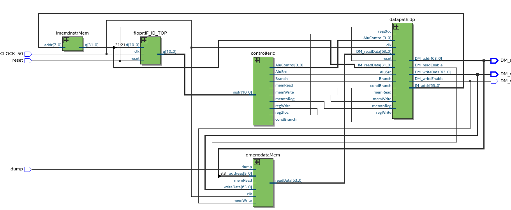

<h1 align="center"> FaMAF-UNC:  Arquitectura de Computadoras 2024
<h2> Alumna: Fernandez Dianela Ivonne

## Ejercicio 1

### Archivos modificados

- [maindec.sv](modulos/maindec.sv): Se agregaron instrucciones, ADDI y SUBI (instrucciones de tipo I). Las flags correspondientes son:
  - Reg2Log: 0
  - ALUSrc: 1
  - MemtoReg: 0
  - RegWrite: 1
  - MemRead: 0
  - MemWrite: 0
  - Branch: 0
  - ALUOp: 10

- [aludec.sv](modulos/aludec.sv): Se modificó el módulo para que tenga en cuenta las instrucciones agregadas, y establezca ALUControl en 0010 y 0110 respectivamente.

- [signext.sv](modulos/signext.sv): Se modificó el módulo para que extienda además ALU_immediate si se trata de una instrucción de tipo I.

### Programa modificado

Se utilizó el código adjuntado a continuación para comprobar el comportaiento del microprocesador actualizado, este código fue modificado para que no cambie el comportamiento externo (el resultado en memoria es el mismo al del programa provisto por la cátedra) y ademas utiliza las nuevas instrcciones implementadas (los ADD y SUB cuyo segundo parámetro es un inmediato, corresponden a las instrucciones tipo I).
Para evitar hazards se agregaron instrucciones NOP (corresponden a los ADD  XZR, XZR, XZR)

El código se puede encontrar en [test.s](asm/test.s)

## Ejercicio 2

### Archivos modificados (cambios más significativos):

- [alu.sv](modulos/alu.sv): Se agregó lógica para calcular el complemento de b para poder operar con el mismo. Se setearon las flags necesarias (zero, negative, carry, overflow) y la señal 'write_flags' la cual nos indica si se deben actualizar las flags o no.

- [aludec.sv](modulos/aludec.sv): Se modificó para que tenga en cuenta las instrucciones ADDIS, SUBIS, ADDS y SUBS, y establezca ALUControl en 1010, 1110, 1010 y 1110 respectivamente.

- [bcondcheck.sv](modulos/bcondcheck.sv): En este módulo se determina si un branch debe ejecutarse o no. La salida 'doBranch' es 1 si el salto se ejecuta, y 0 si no.

- [datapath.sv](modulos/datapath.sv): Se agregaron las flags necesarias y sus conexiones.

- [execute.sv](modulos/execute.sv): Se actualizaron las flags que genera la ALU, 

- [maindec.sv](modulos/maindec.sv): Se agregaron dos tipos de instrucciones, ADDIS, SUBIS, ADDS y SUBS. Las dos primeras son instrucciones de tipo I. Las ultimas dos instrucciones son instrucciones de tipo R

- [memory.sv](modulos/memory.sv): Se incorporan las señales condBranch_M y doBranch_M para manejar los saltos condicionales.

- [singext.sv](modulos/singext.sv): Se modificó para que extienda las instrucciones ADDS Y SUBS.

### Nuevo microprocesador

### Programa de prueba

El programa puede ser encontrado en [test2.s](asm/test2.s)
