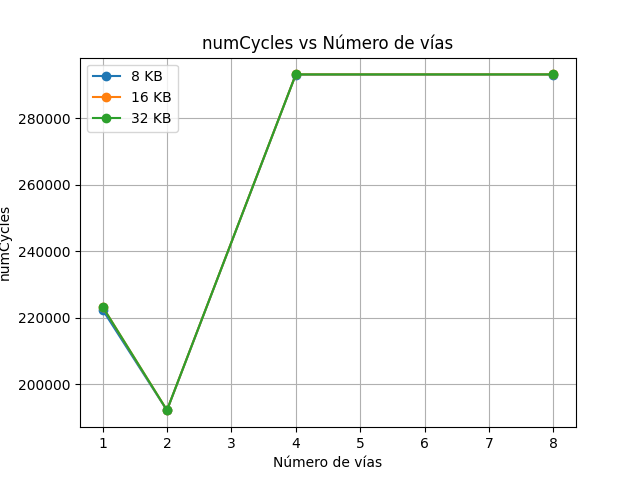
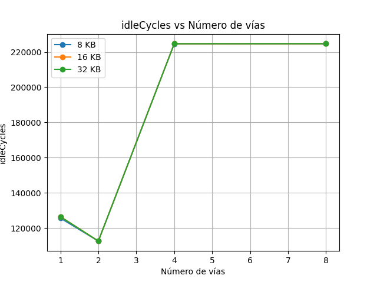
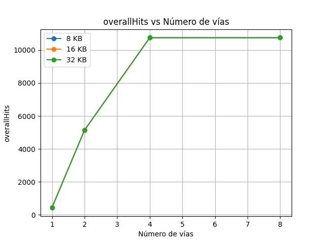
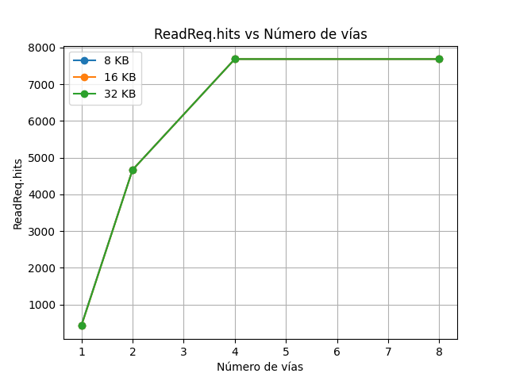
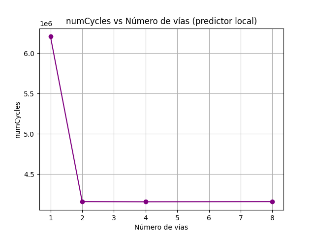
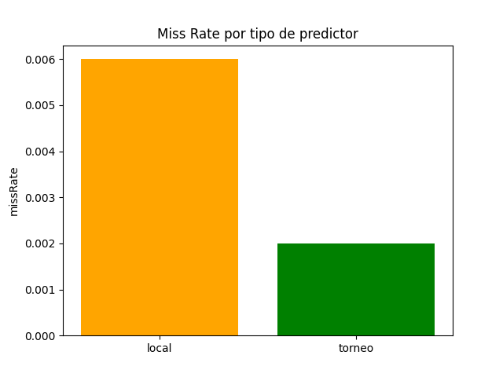
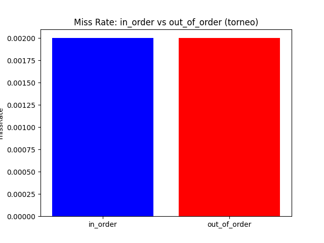

<h1 align="center">Informe laboratorio 2:  Análisis de microarquitecturas - AdC 2024</h1>

<h2>Alumna: Fernandez Dianela.

# Ejercicio 1

# Analisis del procesador in-order (código NO optimizado):

**numCycles:**

**idleCycles:**

**overallHits:**

**ReadReq.hits:**

## Conclusiones:

En estos resultados, se puede observar que el tamaño de la caché tiene un impacto prácticamente despreciable en el rendimiento. Esto se debe a que cada elemento de los arreglos se utiliza solo una vez durante el ciclo. Por lo tanto la caché puede reemplazar datos sin que esto afecte significativamente el rendimiento, salvo en el caso de que ocasione una mínima cantidad de ciclos ociosos.
La cantidad de vías tiene un impacto notable en el rendimiento. 
Por otro lado, lo que sí influye de manera notable en el rendimiento es la cantidad de vías de la caché. A medida que se aumenta el número de vías, mejora la tasa de aciertos en caché, aunque también pueden incrementarse los ciclos ociosos (excepto dos vías). Sin embargo, este aumento tiene un límite: En particular, luego de cuatro vías, el rendimiento tiende a estabilizarse.

El aumento de ciclos ociosos se puede atribuir a la mayor complejidad en la asociatividad. En particular, la configuración de dos vías parece ser la más eficiente, ya que equilibra bien el tiempo de acceso con una tasa razonable de aciertos.

En cuanto al aumento de hits en caché, esto puede explicarse por la forma en que está construido el benchmark. En particular al uso de tres vectores específicos en memoria: X, Y, y Z (Se comprobó que las instrucciones de store también pasan a la caché de datos). Como cada uno corresponde a un segmento contiguo distinto de memoria, se necesitarían tres vías para alojar un bloque por cada vector en el caso de que los bloques requeridos se correspondan al mismo conjunto. 

Como se trabaja con una cantidad de vías que es potencia de dos, el mejor hit ratio se obtiene a partir de cuatro vías.

# Código optimizado - Caché 32 kB, 1 vía:

Para la optimización de Daxpy se implementó loop unrolling, desglosando el ciclo en un factor de 8 etapas. Además, se ajustó el orden de las instrucciones para evitar los hazards de datos entre las variables,utilizando los datos una vez se hayan traído de la memoria. Este código se puede encontrar en [daxpyOptimized.s](benchmarks/daxpyOptimized.s)

**Procesador in-order:**

| Técnica                      | numCycles  | idleCycles  | overallHits  | ReadReqHits    |
|:----------------------------:|:----------:|:-----------:|:------------:|:--------------:|
| Loop unrolling x8            |  175069    |    142509   |   8382       |   6299         |

**Procesador out-of-order:**

| Técnica                      | numCycles  | idleCycles | overallHits  | ReadReqHits    |
|:----------------------------:|:----------:|:----------:|:------------:|:--------------:|
| Loop unrolling x8            |  37309     |    689     |   4488       |   3306         |

## Conclusiones:

La optimización resultó efectiva, y dió mejores resultados. El microprocesador in-order con memoria directa tuvo el doble de hits de caché que el microprocesador con memoria asociativa de dos vías.

Sin embargo, podemos ver que el procesador out-of-order reduce de manera drástica la cantidad de ciclos que demora el benchmark en correr. Se puede notar el gigantesco salto en eficiencia que significan estos nuevos tipos de procesadores.

# Ejercicio 2

# Tamaño caché 32 kB, predictor de saltos local, diferente cantidad de vias:

**numCycles:**

## Conclusiones:

Se observa una mejora en el rendimiento cuando se utilizan dos o más vías. El caso con una sola vía es el peor, debido a la alta cantidad de sobrescrituras que se producen. En cambio, al contar con dos o más vías, el rendimiento mejora considerablemente, ya que es posible almacenar un arrglo de datos por vía.

# Diferencias entre predictores de saltos

## Procesador out_of_order:

## Conclusiones:

El predictor por torneo ofrecería un mejor rendimiento que el local, ya que logra adaptarse a diferentes tipos según el contexto de los mimsos.

Como se puede observar, la diferencia entre un procesador in_order y uno out_of_order, donde ambos usan predictor de saltos por torneo, es practicamente nula.